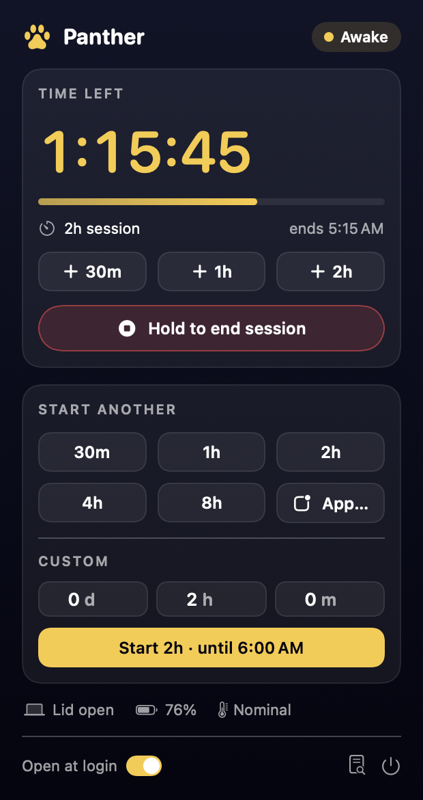
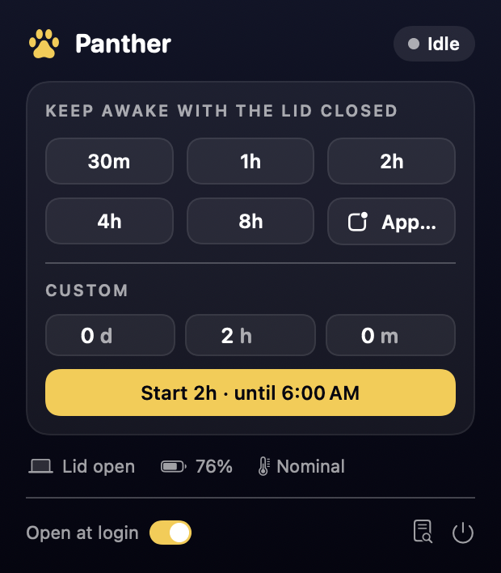
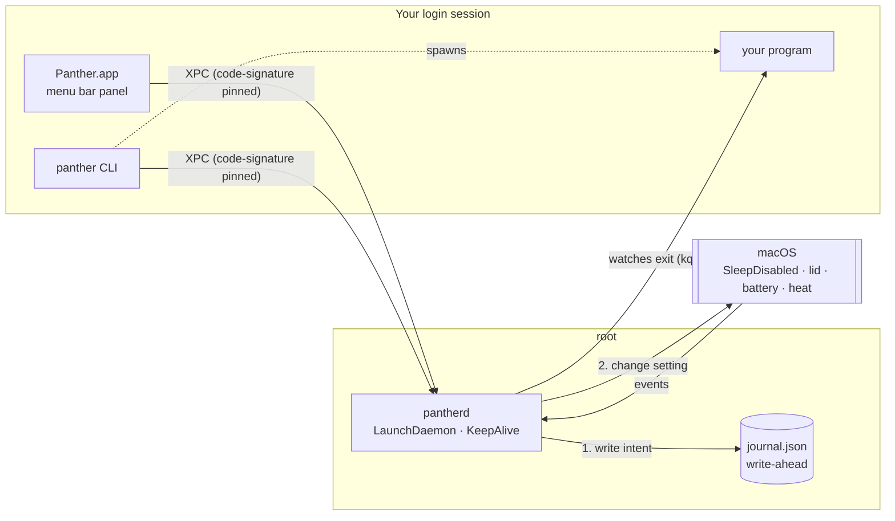

<p align="center">
  
</p>

<h1 align="center">Panther</h1>

<p align="center">
  <b>Close the lid. Keep working.</b><br>
  A macOS menu bar app and CLI that keeps your MacBook running with the lid closed,<br>
  for a set time or until your program finishes, and always puts sleep back afterwards.
</p>

<p align="center">
  
  
  
  
  
</p>

<p align="center">
  
  &nbsp;&nbsp;
  
</p>

> **Why "Panther"?** A panther sees in the dark. When the lid closes, the camera sees only darkness, but the Mac keeps going.

---

## The problem

You start a long job (training a model, a big build, a download, a coding agent) and want to close the lid and walk away. macOS puts the Mac to sleep the moment the lid shuts, and the usual keep-awake tools (`caffeinate`, most menu bar apps) **can't stop that**. They only block *idle* sleep.

There's exactly one switch that blocks lid-close sleep, the system setting `SleepDisabled` (`pmset disablesleep`). It's global, needs root, and stays on until someone turns it off. Leave it on by accident and your Mac never sleeps in your bag again.

Panther is built around handling that one switch safely.

## Features

- **Keep awake until a program finishes**: `panther run -- python train.py`. When it exits, sleep comes back.
- **Timed sessions** from the menu bar or the CLI: presets from 30 min to 8 h, or **any custom length up to 3 days** (days · hours · minutes), extend any time.
- **"Until an app quits"**: pick a running app from the panel.
- **Live countdown in the menu bar** (`1:23:45`) at about 0.5% of one CPU core while ticking, and zero when idle.
- **Hold for 2 seconds to end**, so you can't end a long job by accident.
- **Sleeps when it's done.** If the session ends with the lid still closed, Panther puts the Mac to sleep instead of leaving it awake for hours.
- **Screen and keyboard light off** while the lid is closed. Otherwise macOS leaves the panel lit inside the closed lid when sleep is disabled.
- **Low Power Mode** on battery while the lid is closed. Panther never touches Low Power Mode you turned on yourself.
- **Safety rules that can't be switched off:** ends sessions at 10% battery, at critical heat, and after 10 minutes of heavy heat with the lid closed and no display ("in a bag?").
- **Crash-safe.** If anything dies, launchd restarts the daemon and it puts the Mac back to normal.
- **External monitor aware.** Closed lid plus an external display counts as "in use", so nothing gets dimmed or frozen.

## How it works



| Part | Runs as | Job |
|---|---|---|
| `pantherd` | root, LaunchDaemon | The **only** thing that touches `SleepDisabled` and Low Power Mode. Holds the session clock, the safety rules and the journal |
| `panther` | you | CLI. `run` starts your program and ties the session to it |
| `Panther.app` | you | Menu bar panel. A remote control: quitting it never ends a session |

Three rules make it safe:

1. **One owner.** Only the daemon changes the global setting, and it's the part least likely to crash: small, no UI, restarted by launchd.
2. **Write before you change.** Every change goes into a journal *before* it happens. After a crash, recovery reads a list instead of guessing.
3. **Read back.** After every change Panther reads the real value back from the system. If another tool flips it, Panther notices.

## Install

Needs macOS 14 or later and the Swift toolchain: Xcode, or just the Command Line Tools (`xcode-select --install`).

```bash
git clone https://github.com/HarshPatel2035/Panther.git
cd Panther
scripts/build.sh            # as your normal user
sudo scripts/install.sh     # asks for your admin password once
```

The installer finishes with `panther doctor` and opens the app. Look for the paw print in your menu bar.

What gets installed:

| Path | What |
|---|---|
| `/Library/PrivilegedHelperTools/com.panther.daemon` | the root daemon |
| `/Library/LaunchDaemons/com.panther.daemon.plist` | launchd job (KeepAlive, Mach service `com.panther.daemon`) |
| `/usr/local/bin/panther` | CLI |
| `/Applications/Panther.app` | menu bar app |
| `/Library/Application Support/Panther/journal.json` | the journal (root only) |
| `/Library/Logs/Panther/pantherd.log` | log |

**No sudoers rule.** The daemon only accepts connections from the exact `panther` and `Panther.app` binaries that were installed (their code-signature hashes are pinned at install). That's why you re-run `sudo scripts/install.sh` after each rebuild.

### Uninstall

```bash
sudo scripts/uninstall.sh            # restores sleep, removes everything
sudo scripts/uninstall.sh --purge    # also deletes the journal and logs
```

It refuses to remove anything while sleep is still disabled.

## Usage

**Menu bar:** click the paw print.

- Presets: 30m · 1h · 2h · 4h · 8h, or **App…** to stay awake until an app quits
- **Custom**: set days, hours and minutes (up to 3 days); the button tells you when it will end
- **+30m / +1h / +2h** while a session runs
- **Hold to end** (2 seconds)
- Open at login · log · quit (sessions keep running)

**Terminal:**

```bash
panther run -- python train.py        # awake until it exits (at most 8 h)
panther run --max 3h -- ./build.sh    # with your own cap
panther start 2h                      # timed (also 90m, 1h30m, 2d)
panther extend 30m
panther status                        # or: panther status --json
panther end
panther doctor                        # checks it really works, not just that it's installed
```

`panther run` passes your program's exit code straight through, so it works inside scripts.

## Safety rules

| Rule | Default | Can you turn it off? |
|---|---|---|
| Longest session | 3 days (`run` defaults to 8 h; use `--max 2d` for longer) | raise it up to 7 days, never unlimited |
| Battery floor (on battery) | ends at 10% | raise or lower, never below 5% |
| Critical heat | ends and sleeps immediately | no |
| Heavy heat for 10 min, lid closed, no display | ends and sleeps ("in a bag?") | no |
| Low Power Mode | on while closed on battery, or below 30% | it's automatic, and never overrides yours |

Use it on a desk, not in a closed bag.

## Tested for real

On a MacBook Air M2 with macOS 27.0.1 (2026-11-07), `panther run -- spikes/lid-test.sh 300` logged one timestamp per second:

- The lid was closed for about 2.5 minutes in the middle: **292 timestamps, 0 gaps.**
- When the job finished with the lid still closed, sleep was restored and the Mac went to sleep **5 seconds later** (macOS power log: `Entering Sleep state due to 'Software Sleep'`).
- When the lid opened, it woke normally.

The screen-off and Low Power Mode part (Phase 3) is built and unit-tested; its real closed-lid test is next.

## Reverse engineering

Apple doesn't document how `pmset disablesleep` works, so Panther finds out from Apple's own binaries:

- **`/usr/bin/pmset`** (`otool`, `nm`): the setting is `IOPMSetSystemPowerSetting("SleepDisabled")`, and "sleep now" is `IOPMSleepSystem`. Panther calls these from IOKit directly, with no shell and no sudo.
- **pmset's hidden `clamshell` command** sets `IOPMTestClamshellClose` on `IOPMrootDomain`. Production kernels refuse it, even for root.
- **`DisplayServices.framework`**: a small dumper ([`tools/fndump.c`](tools/fndump.c)) disassembles functions from the shared cache and resolves their calls. It found the brightness API. `PowerMode` exists but isn't supported on built-in panels.
- **`CoreBrightness.framework`** ([`tools/objcdump.m`](tools/objcdump.m)): the keyboard backlight class `KeyboardBrightnessClient`, and why auto-brightness must be switched off while the lid is closed.

Full write-ups:
- [Audit of the tool that inspired this](docs/01-audit.md)
- [Architecture](docs/02-architecture.md)
- [Reverse-engineering findings](docs/03-re-findings.md)

## Security model and known limits

- Any program on the Mac can run `/usr/local/bin/panther`, just as it could run `caffeinate`. It can start sessions, but only within the caps (3 days each, 16 at most) and the safety rules. It can't touch sleep settings directly.
- Sessions belong to the user who started them. You can only extend or end your own (root can do all), and `run` can only be tied to your own processes.
- The CLI and the app tell the daemon whether an external display is in use, because a root daemon has no WindowServer connection. The daemon trusts that for 2 minutes, then assumes "no display", which is the safe side.
- Session labels are just the program name, because full command lines can hold secrets and the log is readable by every account on the Mac.
- The installer copies the build into a root-owned staging folder before verifying and installing it, so nothing can swap the files in between.
- Screen and keyboard dimming need the menu bar app running. The sleep guard, safety rules and Low Power Mode don't.
- `kill -INT` sent straight to `panther run` is ignored; use Ctrl-C in the terminal or SIGTERM.
- If you had set `pmset -a disablesleep 1` yourself, Panther resets it to 0 when its session ends.
- The builds are ad-hoc signed, not notarized: you build from source.

## Project layout

```
Sources/
  PantherCore/     pure logic: sessions, safety, Low Power policy, journal, reconcile (no IOKit, fully tested)
  PantherSystem/   macOS adapters: IOKit power, lid, battery, heat, displays, backlights, pmset
  PantherIPC/      JSON-over-XPC messages and client
  pantherd/        root daemon
  panther/         CLI
  PantherUI/       SwiftUI menu bar panel
  PantherApp/      app entry point
  panther-snapshot/  renders the panel to PNG (design checks without a daemon)
Tests/             56 Swift Testing tests (fakes only: they never touch your real power settings)
scripts/           build, install, uninstall, test, icon
spikes/            Phase 0 reverse-engineering test programs (C / Objective-C) and real-lid test scripts
tools/             fndump.c and objcdump.m
docs/              audit, architecture, findings, images
```

## Development

```bash
scripts/test.sh                       # unit tests
swift build
swift run panther-snapshot docs/assets   # re-render the panel images
make -C spikes                        # build the reverse-engineering spikes
```

With only the Command Line Tools, `scripts/test.sh` adds the Swift Testing plugin path that `swift test` misses. SwiftUI's macro plugin isn't shipped there either, which is why the UI uses `@Observable` classes instead of `@State`.

## Roadmap

- [x] Phase 0: reverse-engineer the APIs
- [x] Phase 1: root daemon, journal, CLI, `run -- cmd`, real-lid test
- [x] Phase 2: menu bar app with countdown and hold-to-end
- [x] Phase 3: screen and keyboard light off, Low Power Mode (real-lid test pending)
- [ ] Notifications, a Homebrew tap, notarized builds
- [ ] Optional extras: pause chat apps while closed, Wi-Fi to hotspot failover

## Credits

The idea comes from [Insomnia](https://github.com/krishhgg/Insomnia) by krishhgg. Panther is a separate implementation with a different design, written from scratch; [docs/01-audit.md](docs/01-audit.md) explains what was learned and changed. Reverse-engineering approach inspired by [REA](https://github.com/morluto/rea). Built with [Claude Code](https://claude.com/claude-code).

Not affiliated with Apple. "Panther" here is just a night animal, unrelated to Mac OS X 10.3.

## License

[MIT](LICENSE)
