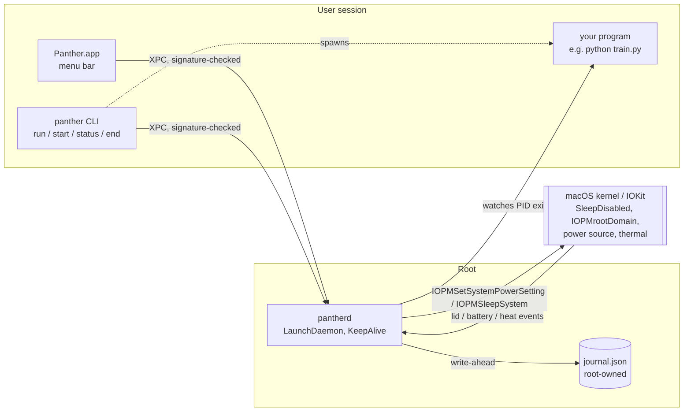
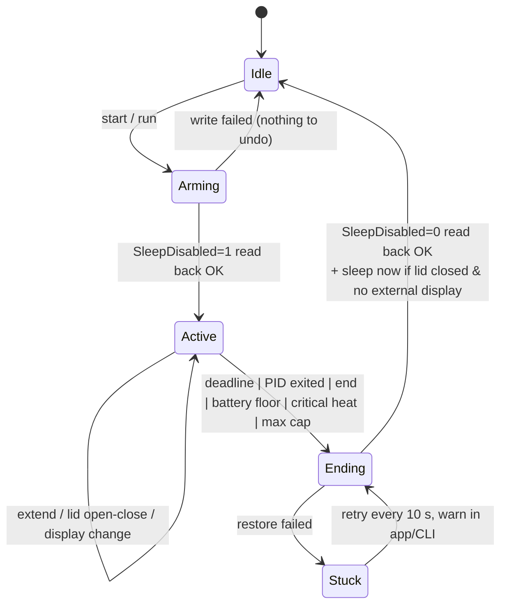

# Panther — Architecture

> A panther sees in the dark. When the lid closes, the camera sees darkness, and Panther keeps working.

Panther keeps a MacBook running with the lid closed, **for a fixed time or until a program finishes**, and always puts the Mac back to normal afterwards, even if Panther's own app crashes.

Same idea as Insomnia, different design. Every decision below answers a specific Insomnia failure from `01-audit.md`.

**Decisions (2026-11-07):** name stays **Panther** · ad-hoc signing + `install.sh` (no paid Apple account) · v1 = core daemon + CLI + menu bar app · install REA + Ghidra at Phase 0, after you review what setup changes.

---

## 1. Goals and non-goals

**Goals**
1. `panther run -- <command>` keeps the Mac awake until that command exits. This is the headline feature.
2. `panther start 2h` keeps it awake for a set time. Every session has an end; there is no plain "on" toggle.
3. Sleep is restored by a process that **can't be the one that crashed**: a root daemon that launchd restarts on its own.
4. When a session ends with the lid closed, the Mac **actually goes to sleep** (Insomnia #94).
5. The built-in screen and keyboard light turn off when the lid closes (no lit panel cooking inside the lid).
6. Hard safety limits live in the daemon: battery floor, critical heat, maximum session length.
7. No sudoers rule. Nothing except Panther's signed binaries can disable sleep.

**Non-goals for v1:** hotspot failover, tmux nudging, freezing chat apps, Docker freezing, Chrome relaunch, Intel Macs. These can come later as optional plugins; each one adds state that has to be undone.

---

## 2. The big picture



Three binaries, one owner of power state:

| Binary | Runs as | Owns |
|---|---|---|
| `pantherd` | root, LaunchDaemon with `KeepAlive` | **All** sleep state, the session clock, safety rules, the journal |
| `panther` | you, in Terminal | Starting or ending sessions, `run -- cmd` |
| `Panther.app` | you, menu bar | Shows status; lid actions that need your login session (screen and keyboard light off) |

**Why this fixes Insomnia's core weakness.** In Insomnia the SwiftUI app held the dangerous global setting, and a 60-second polling script cleaned up after it crashed. In Panther the UI can crash, hang or be force-quit, and nothing bad happens. The daemon still ends the session on time. If the daemon itself is killed, launchd restarts it within a second, and its first action on startup is **reconcile** (section 5).

---

## 3. Components

### 3.1 `pantherd`, the root daemon

- Installed at `/Library/PrivilegedHelperTools/com.panther.daemon`, with plist `/Library/LaunchDaemons/com.panther.daemon.plist` (`KeepAlive=true`, `RunAtLoad=true`, `MachServices: com.panther.daemon`).
- **Sleep control:** calls `IOPMSetSystemPowerSetting(kIOPMSleepDisabledKey, true/false)` directly. This is the API we found inside `pmset`. No shell, no sudo. It reads the value back after every write (an idea kept from Insomnia).
- **Sleep at the end:** `IOPMSleepSystem()` when a session ends with the lid closed and no external display.
- **Sensors** (all event-driven, no polling loops):
  - Lid: IOKit interest notification on `IOPMrootDomain`, key `AppleClamshellState`.
  - External display: `CGGetOnlineDisplayList`, but the daemon has no display session, so the app reports it over XPC. On its own the daemon assumes "no display" when the app is absent (the safe choice).
  - Power: `IOPSNotificationCreateRunLoopSource` for battery percent and charger.
  - Heat: `ProcessInfo.thermalState` plus battery temperature from `AppleSmartBattery`.
- **Process-bound sessions:** `DispatchSource.makeProcessSource(pid, .exit)`, a kqueue `NOTE_EXIT` watch. The kernel tells us the moment your program exits. No polling.
- **Single timer:** one `DispatchSourceTimer` on the wall-clock deadline, re-armed after wake and on clock changes. This avoids Insomnia #119, where a clock step broke the end time.

### 3.2 IPC (`PantherIPC`, a shared Swift module)

- `NSXPCConnection` to Mach service `com.panther.daemon`.
- **Caller check:** `connection.setCodeSigningRequirement(...)` (macOS 13+). Only Panther's own CLI and app can talk to the daemon. The requirement is pinned at install time: the Team ID if you sign with an Apple Developer certificate, otherwise the exact cdhash of the installed build (the same trick Insomnia used for its backstop).
- Protocol (small on purpose):

```swift
@objc protocol PantherDaemonProtocol {
    func start(_ request: SessionRequest, reply: @escaping (SessionStatus?, PantherError?) -> Void)
    func extend(by seconds: TimeInterval, reply: @escaping (SessionStatus?, PantherError?) -> Void)
    func end(reason: String, reply: @escaping (SessionStatus?, PantherError?) -> Void)
    func status(reply: @escaping (SessionStatus) -> Void)
    func reportDisplays(externalActive: Bool)            // from Panther.app
}
// SessionRequest: .timed(duration) | .untilExit(pid, maxDuration)
```

### 3.3 `panther` CLI

```
panther run [--max 8h] -- python train.py     # awake until it exits (hard cap 8h)
panther start 2h30m                           # timed
panther extend 30m
panther status                                # state, ends at, lid, battery, heat, last 5 events
panther end
panther doctor                                # is SleepDisabled really 1? who blocks sleep? (pmset -g assertions)
```

`run` spawns your command as a child, passes its PID to the daemon, forwards signals, and exits with the child's exit code. You can use it in scripts unchanged. If the CLI is killed, the daemon still sees the child exit, or hits the cap.

### 3.4 `Panther.app`, the menu bar

- SwiftUI `MenuBarExtra` with **`.menuBarExtraStyle(.menu)`**, which is a real native `NSMenu`. It sidesteps the macOS 27 click bug completely (Insomnia #60/#112/#128), because there are no custom click or hold gestures inside the status item.
- The countdown label updates **once per minute**, and once per second only while the menu is open. Lid closed means no redraws at all. That fixes the ~48% CPU of Insomnia #164.
- **Lid actions** (they need your login session, so they live here, not in root): on lid close with no external display, save the brightness and set the panel and keyboard light off. Restore them on open. If the app is dead, the worst case is "the screen stays lit". The Mac still ends its session safely.
- A small "evidence" line answers Insomnia #123: "Lid closed 01:12 · stayed awake · 0 sleep events · battery 81→64%".

### 3.5 Code layout

```
Panther/
├── Package.swift
├── Sources/
│   ├── PantherCore/        # pure Swift: SessionMachine, SafetyPolicy, Journal model. No IOKit → fully unit-testable
│   ├── PantherSystem/      # IOKit/Darwin adapters behind protocols (PowerControl, LidSensor, PowerSource, Thermal, ProcessWatch)
│   ├── PantherIPC/         # XPC protocol + Codable message types
│   ├── pantherd/           # daemon entry point: wires Core + System + IPC
│   ├── panther/            # CLI (swift-argument-parser)
│   └── PantherApp/         # menu bar app
├── Tests/
│   ├── PantherCoreTests/   # state machine, safety rules, journal recovery (fakes only)
│   └── PantherSystemTests/ # adapters against fakes
├── scripts/  install.sh  uninstall.sh  build.sh
└── docs/
```

Rule: no file over ~400 lines. `PantherCore` never imports IOKit, so all the risky logic is tested without touching your real power settings.

---

## 4. Session state machine (in `PantherCore`)



While `Active`, the lid sub-state decides what to do:

| Lid | External display | What Panther does |
|---|---|---|
| open | any | nothing extra |
| closed | **yes** (clamshell desk setup) | nothing extra: you're using the Mac (fixes #97) |
| closed | no | screen and keyboard light off, safety rules tighten (see 6) |

---

## 5. Journal and recovery

Same principle as Insomnia (write-ahead), much less state:

```json
// /Library/Application Support/Panther/journal.json  (root:wheel, 0600)
{
  "version": 1,
  "bootSessionUUID": "…",          // kern.bootsessionuuid
  "sleepDisabledByPanther": true,
  "session": { "kind": "untilExit", "pid": 4242, "pidStartMicros": 1730000000123456,
               "endsAt": "2026-11-07T22:00:00Z", "startedAt": "…" }
}
```

- Written atomically (temp file + `rename`) **before** setting `SleepDisabled=1`.
- **Reconcile** runs every time the daemon starts:
  - Journal says we disabled sleep, but the boot session changed, the deadline passed, or the PID is gone (checked against its start time so a reused PID doesn't fool us): restore sleep, and sleep now if the lid is closed.
  - Journal says a session is still valid: resume it and re-arm the timer and PID watch.
  - No journal but `SleepDisabled=1`: someone else set it. Leave it alone and report it in `panther doctor`.
- Only the daemon writes the journal. One writer means no lock files.

---

## 6. Safety rules (in the daemon, so they work even with no UI)

| Rule | Default | Can turn off? |
|---|---|---|
| Max session length | 12 h (`run` default cap 8 h) | raise only, never infinite |
| Battery floor, on battery | end at 10% | yes, but min 5% |
| Low Power Mode | on below 30% while lid closed | yes |
| Critical heat (`thermalState == .critical`) | end + sleep immediately | **no** |
| Thermal pressure ≥ heavy for 10 min with lid closed + no display ("in a bag?") | end + sleep | **no** |
| Thermal pressure trapping/sleeping at any time | end + sleep | **no** |

Battery temperature is not exposed on macOS 27 / M2 (reads 0, see `03-re-findings.md`), so heat comes from `kOSThermalNotificationPressureLevelName` + `ProcessInfo.thermalState`. Screen off = `DisplayServicesSetBrightness(0)` first, then `SLSDisplayManagerRequestDisplaysIdle` (best effort).

Panther still tells you, like Insomnia: use it on a desk, never in a closed bag.

---

## 7. Install and security model

**v1 (no paid Apple account needed):**
1. `scripts/build.sh` runs `swift build -c release`, assembles `Panther.app`, and signs it (ad-hoc, or with your certificate if you have one).
2. `scripts/install.sh`, run by you and asks for your admin password once:
   - copies `pantherd` → `/Library/PrivilegedHelperTools/` (root:wheel 0755)
   - writes the LaunchDaemon plist with the pinned code requirement, then `launchctl bootstrap system …`
   - copies `Panther.app` → `~/Applications`
3. `scripts/uninstall.sh` ends any session, restores sleep, unloads and removes everything.

**Later, with a paid Developer ID:** replace the script with `SMAppService.daemon(plistName:)`, so macOS shows an approval prompt in System Settings › Login Items. Notarized download, notifications work.

**Compared with Insomnia:** no sudoers file. A random process running as you **can't** disable sleep, because the daemon rejects any XPC caller that isn't Panther's signed code.

---

## 8. Testing plan

- **Unit (`PantherCore`):** state machine transitions, every `Ending` trigger, reconcile cases (crash mid-arm, reboot, PID reuse, clock jump), safety rules. Fakes only. Target 80%+.
- **Integration (`PantherSystem`):** adapters against fake IOKit shims; real-IOKit tests behind an opt-in `PANTHER_LIVE=1` flag.
- **Lid simulation:** the kernel refuses the hidden `IOPMTestClamshellClose` path, even as root (Phase 0). Lid logic is tested through a fake `LidSensor`; the real lid is covered by the manual checklist below.
- **Real-Mac checklist (manual, before each release):** close the lid for 30 min while `panther run -- ping` writes to a log. Check no gaps, and that the Mac sleeps within 60 s after the job ends with the lid still closed.

---

## 9. Roadmap

| Phase | Deliverable | Done when |
|---|---|---|
| **0. RE spikes** | Prove from Swift as root: `IOPMSetSystemPowerSetting(SleepDisabled)` on macOS 27; `IOPMSleepSystem`; the lid simulation path; one reliable "panel off" method (DisplayServices, which needs REA + Ghidra) | 4 tiny throwaway programs, results written in `docs/03-re-findings.md` |
| **1. Core** | `PantherCore` + tests, `pantherd`, `panther` CLI (`start`, `run`, `status`, `end`, `doctor`), install and uninstall | `panther run -- sleep 600` with the lid closed works, and recovery works after `kill -9 pantherd` |
| **2. Menu bar** | `Panther.app` with native menu, countdown, evidence line | starts, extends and ends a session; no CPU when idle |
| **3. Lid & safety** | screen and keyboard light off, sleep at end, battery, heat and bag rules | real-Mac checklist passes |
| **4. Polish** | icon, notifications, Homebrew tap, optional plugins | — |

---

## 10. Insomnia problem → Panther answer

| Insomnia problem | Panther answer |
|---|---|
| sudoers rule usable by any process | root daemon + signature-checked XPC |
| UI app owns the dangerous state | daemon owns it; UI is just a remote control |
| 60 s polling backstop | launchd `KeepAlive` daemon + reconcile on start |
| End button broken on macOS 27 (#60) | native `NSMenu` via `MenuBarExtra(.menu)` |
| 48% CPU countdown (#164) | minute-level updates, none with the lid closed |
| Mac awake for hours after session (#94) | `IOPMSleepSystem` at session end when the lid is closed |
| External-display clamshell mistreated (#97) | lid sub-state checks external displays |
| Clock change broke the end (#119) | wall-clock deadline timer re-armed on clock and wake events |
| Only timed sessions | `panther run -- cmd` (until your program exits) |
| 3,209-line file, huge scope | small modules, pure tested core, extras deferred |
